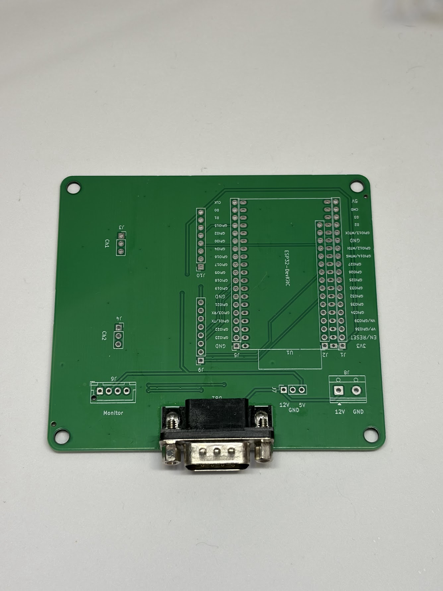
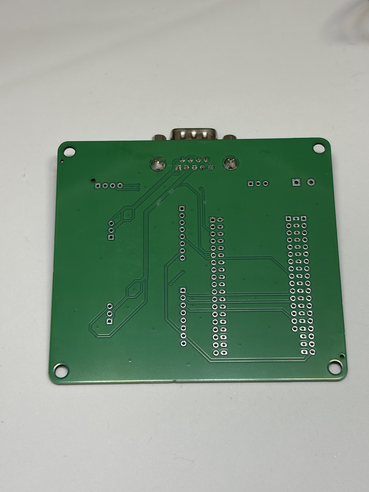
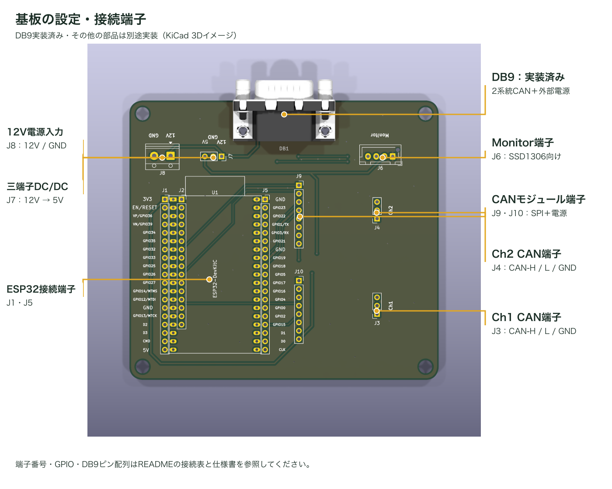
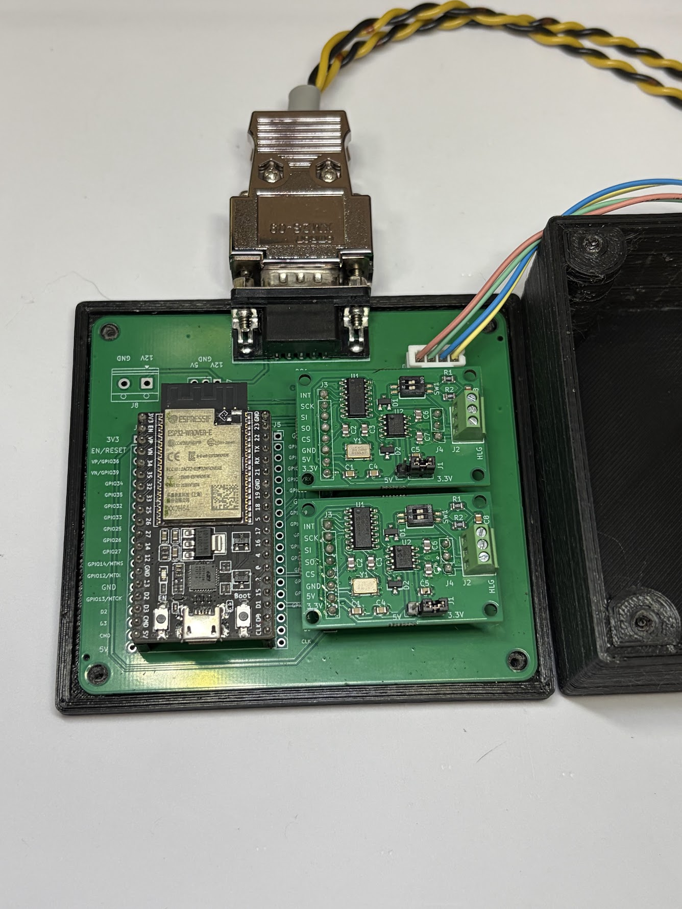
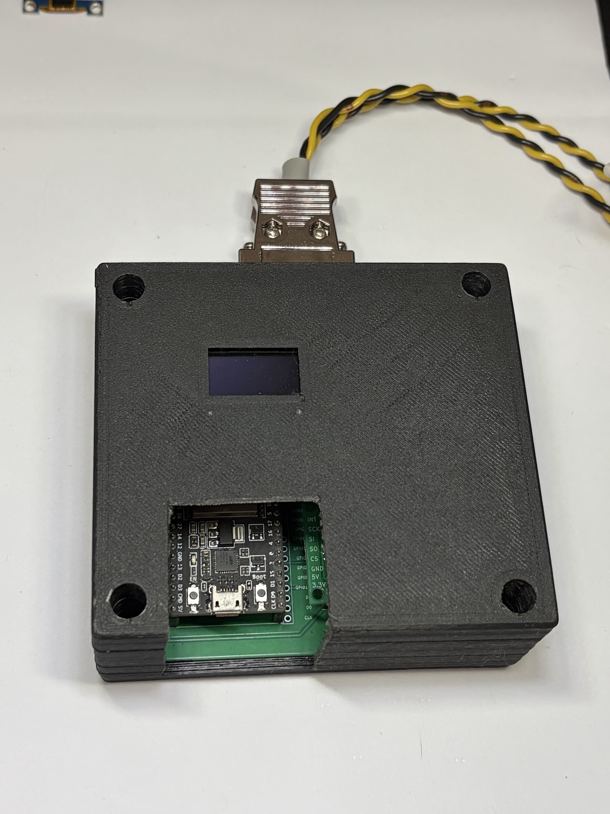

# ESP32 CAN-FD GateWay CombiBoard｜公開用リポジトリ

ESP32開発ボード と MCP2518 + MCP2562FD CAN FD Busモジュール x2 を接続するための実験用基板、ESP32_CAN-FD_GWCombiBoardの資料です。

## 特徴

- [ESP32-DevKitC-32E](https://akizukidenshi.com/catalog/g/g115673/)、[ESP32-DevKitC-VE](https://akizukidenshi.com/catalog/g/g115674/)、[AE-ESP32-WROOM-32E-MINI](https://akizukidenshi.com/catalog/g/g116108/)に、[CAN FDモジュール](https://github.com/TLDSJPWORK/CAN-FD_Board)、[有機ELディスプレイ（SSD1306）](https://akizukidenshi.com/catalog/g/g112031/)、[三端子DC/DCレギュレーター](https://akizukidenshi.com/catalog/g/g111188/)をまとめて接続できる実験用基板です。モジュール間の配線の手間を減らし、通信実験の環境を組み立てやすくします。
- CAN FDモジュールを2個接続できるため、1台のESP32で2系統のCANバスを扱う構成を作れます。2つのバス間でメッセージを転送するゲートウェイの実験にも使えます。
- MCP2518向けのドライバ・ライブラリを使い、CANおよびCAN FDの送受信をプログラムできます。各チャンネルのGPIO割当は[仕様書](docs/hardware.md)にまとめています。
- 2系統のCAN信号と外部電源をDB9（D-Sub）コネクタにまとめられるため、実験装置への接続をケーブルで整理できます。
- [有機ELディスプレイ（SSD1306）](https://akizukidenshi.com/catalog/g/g112031/)用のMonitor端子を備え、通信状態や受信データを表示する構成に拡張できます。
- 三端子DC/DCレギュレーターを取り付けることで、12V電源から5Vへ降圧して給電する構成を作れます。
- KiCad設計データ・基板STEP・上下筐体STLを公開しているため、配線の確認や独自の改造、筐体の製作にも活用できます。

2系統を使う実験やゲートウェイ用途を想定しています。

## 基板

DB9のみ実装した販売状態の実物写真です。その他の部品は未実装です。

| 表面 | 裏面 |
|---|---|
|  |  |

## 基板の設定

DB9は実装済みです。ESP32、CANモジュール、表示器、DC/DCなどは用途に応じて別途実装をお願い致します。

| 接続部 | 使い方 |
|---|---|
| J1・J2・J5 | ESP32開発ボードを接続します。3V3・5V・GNDと端子番号を合わせて取り付けます。 |
| J9・J10 | CAN FDモジュールの8ピン端子を接続します。モジュールの動作電圧ジャンパは3.3Vに設定して下さい |
| J3（Ch1）・J4（Ch2） | 各CANモジュールのCAN側端子を接続します。1番=CAN-H、2番=CAN-L、3番=GNDです。 |
| J6（Monitor） | SSD1306表示器用。1番=GND、2番=5V、3番=GPIO22、4番=GPIO21です。表示器側の端子順も確認してください。 |
| J7 | BP5293-50を接続します。1番=12V入力、2番=GND、3番=5V出力です。 |
| J8 | 外部電源入力。1番=12V、2番=GNDです。 |
| DB1（DB9・実装済み） | 販売時に実装済みです。2系統のCAN信号と外部電源をまとめて接続します。配列は[仕様書](docs/hardware.md)を参照してください。 |

CANの終端抵抗はCANモジュール側で設定し、各バスの両端で有効にします。外部電源とUSB給電は併用しない前提です。詳しい実装手順は[組立ガイド](docs/assembly.md)を参照してください。

## 対応部品・設計仕様

- 対応ESP32開発ボード：ESP32-DevKitC-32E／ESP32-DevKitC-VE／AE-ESP32-WROOM-32E-MINIのいずれか×1
- MCP2518 + MCP2562FD CAN FD Busモジュール（JP-WORKS-002）×1〜2
- 外部給電用DC/DC：BP5293-50（部品定格：入力7〜26V、出力5V・最大1A）
- 設計外形94×85mm、厚さ1.6mm
- DB9に2系統CANと外部電源を配置。端子配列は[仕様書](docs/hardware.md)を確認してください。

外部電源とUSB給電は併用しない前提です。部品定格は組立例全体の動作保証範囲ではありません。

## 内容物・別途必要な部品

販売内容物はDB9コネクタ実装済みの基板1枚です。その他の部品は別途購入し、購入者がはんだ付けして実装を想定しています。
ESP32、CAN FDモジュール、コネクタ、電源部品、表示器、筐体の型番と同梱有無は[組立ガイド](docs/assembly.md)に整理します。

## 使用例

ESP32開発ボードとCAN FDモジュール2枚を取り付け、DB9ケーブルを接続した組立例です。Monitor端子から表示器へ配線し、3Dプリントした上下筐体に収めています。本例ではUSB給電を前提としたため、筐体を一部切断し、USBをESP32に挿せるようにしております。

| モジュールを取り付けた状態 | 筐体に収めた状態 |
|---|---|
|  |  |

写真のESP32、CAN FDモジュール、表示器、ケーブル、筐体は販売品に含まれません。部品の向きは[組立ガイド](docs/assembly.md)、筐体データは[こちら](mechanical/README.md)を参照してください。

## 資料

- [仕様・接続表](docs/hardware.md)
- [組立・動作確認ガイド](docs/assembly.md)
- [KiCad設計データ](hardware/kicad/)
- [製造データ](hardware/production/)
- [筐体・3Dデータ](mechanical/)
- [上下筐体のSTL・印刷ガイド（MakerWorld）](https://makerworld.com/ja/models/3444573-upper-and-lower-enclosure-for-esp32-can-fd-gateway)
- [サンプルの準備状況](example/README.md)
- [公開・ライセンス整備状況](docs/publication.md)

[回路図PDF](docs/schematic.pdf)も用意しております。基板の表裏写真、接続説明図、組立例を上記に掲載しています。

## 販売・問い合わせ

スイッチサイエンス様での委託販売を予定しています。
- 販売ページ：【発売後掲載】
- 技術問い合わせ先：tldsjpwork@gmail.com

## ライセンス

本プロジェクトのオリジナル設計・製造データ・筐体データ・資料は[CC BY 4.0](LICENSE)で公開します。出典表示：JP WORKS / TLDSJPWORK、ESP32 CAN-FD GateWay CombiBoard。変更した場合は変更内容を明示してください。第三者の素材・ライブラリはそれぞれの利用条件に従います。

## 関連プロジェクト

- [CAN-FD_Board](https://github.com/TLDSJPWORK/CAN-FD_Board)：本基板に接続するCAN FD対応モジュールです。1チャンネルにつき1枚使用します。
- [ESP32_CAN-FD_CombiBoard](https://github.com/TLDSJPWORK/ESP32_CAN-FD_CombiBoard)：CANが1チャンネルでよい用途向けの接続基板です。用途に応じてこちらもご検討ください。
